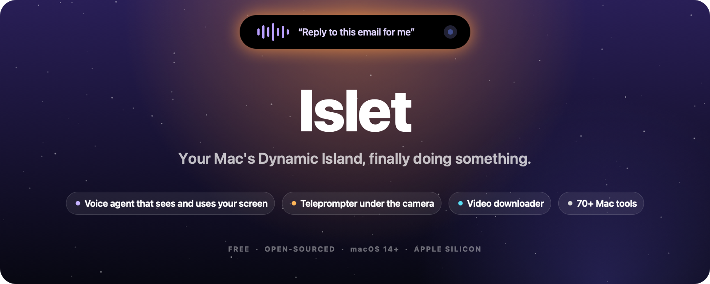
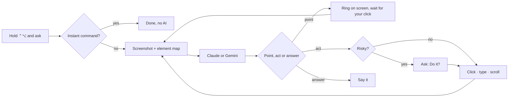

<p align="center">
  
</p>

<p align="center">
  <a href="https://github.com/tbsjmd/islet/releases/latest"></a>
  <a href="https://islet-mac.netlify.app"></a>
  <a href="LICENSE"></a>
  <a href="https://github.com/tbsjmd/islet/stargazers"></a>
</p>

<p align="center">
  <b>Islet</b> turns the notch around your MacBook's camera into a Dynamic Island that does real work:<br>
  a voice agent that sees and uses your screen, a teleprompter that reads along with you, a video downloader,<br>
  and 70+ Mac tools behind one menu bar icon. Free, open-sourced and local-first.
</p>

<p align="center">
  <a href="#-the-assistant">Assistant</a> ·
  <a href="#-the-teleprompter">Teleprompter</a> ·
  <a href="#-the-video-downloader">Video Downloader</a> ·
  <a href="#-everything-else">Everything else</a> ·
  <a href="#-install">Install</a> ·
  <a href="#-build-from-source">Build</a> ·
  <a href="https://islet-mac.netlify.app">Website</a>
</p>

---

## ✦ The Assistant

Hold <kbd>⌃ control</kbd> + <kbd>⌥ option</kbd>, say what you want, let go.

| You say | Islet |
|---|---|
| *"Open Spotify"* · *"volume 30"* · *"dark mode on"* · *"set a 10 minute timer"* | Does it instantly, **no AI at all** |
| *"What does this error mean?"* | Looks at your screen and explains it in a sentence |
| *"How do I export this as a PDF?"* | **Draws a ring on the exact spot** and moves to the next step when you click it |
| *"Reply to this email saying Thursday works"* | **Clicks and types for you**, step by step, showing each step in the island |
| *"Find my lease PDF"* | Searches your Mac with Spotlight and lists the matches |
| *"Explain how DNS works and draw it"* | **Builds a live diagram** in a floating glass canvas, piece by piece |
| *"Show me a 3D model of a jet engine"* | **Builds a 3D model** you can spin with the mouse |
| *"What do these buttons do?"* | **Draws on your screen**: circles, arrows, boxes and labels that trace themselves in |
| *"Remember I prefer aisle seats"* | Keeps it in mind for every later ask |

- **Your sign-in or your key.** Claude on your Claude plan (one-click **Connect**, no API key), a Claude API key, Gemini with your Google sign-in or a free Gemini API key, or any local model server such as Ollama. Pick one in **Settings → Islet → Assistant**.
- **An agent, not just a chatbot.** Each step it reads a screenshot plus a numbered map of the front app's buttons and fields, then clicks, types, presses keys, scrolls or drags until the job is done.
- **Safe by default.** It asks once before it takes over the mouse and keyboard. Anything that sends, buys, deletes or can't be undone waits for your **Do it**. It never types into password fields, the model has no shell, and <kbd>Esc</kbd> stops it instantly.
- **Talks back.** Replies are read aloud in the voice you choose, and the word being spoken lights up. Speech is recognized on your Mac.
- **Alive on screen.** A companion cursor rides beside your pointer and swoops to whatever it's explaining (after [Clicky](https://github.com/farzaa/clicky)). The screen edges glow while it listens, thinks and works, an orb in the island swells with your voice, replies arrive word by word out of a blur, and every click it makes ripples.



## ✦ The Teleprompter

Read your script right under the camera, so your eyes stay on the lens.

- **Word tracking:** it listens and lights up each word as you say it. Skip, ad-lib or go back and it finds you. Click any word to jump.
- **Classic:** steady scrolling at the speed you set. **Voice-activated:** scrolls only while you talk.
- The island stays open while you read, and the closed island shows how far through you are.

Speech engine from [Textream](https://github.com/f/textream).

## ✦ The Video Downloader

Paste a link from YouTube or 1,000+ other sites and it downloads right in the island.

- Video or audio, in Best, 1080p, 720p or 480p. A link already on your clipboard is filled in for you.
- Progress on the closed island, a notice when it's done, and one click to show it in Finder.
- Uses your [yt-dlp](https://github.com/yt-dlp/yt-dlp) or fetches it once. With ffmpeg, streams are merged into MP4 and audio is saved as M4A.

Modeled on [Parabolic](https://github.com/NickvisionApps/Parabolic).

## ✦ Everything else

The island also holds music with lyrics, your calendar, timers, notifications, the clipboard, a file shelf, a camera mirror, system stats and AI coding agent usage. Behind the menu bar icon are 70+ tools you install one by one, so you only load what you use.

<details>
<summary><b>See all 70+ tools</b></summary>

#### Sound

- **Volume mixer.** Set volume per app, boost quiet audio past 100%, and pin or reorder favorites. No audio driver required.
- **Per app output.** Play music through speakers while a call uses your headset.
- **Output switcher.** Switch audio outputs with a shortcut and lower the volume when headphones disconnect.
- **Microphone tools.** Choose a preferred input, adjust its level on supported devices, and apply available microphone mute or input-volume controls with one shortcut. Siri and some apps may still hear you; Mic Mute is not a privacy lock. Its indicator shows that the feature is on, not that every app receives silence.
- **Music app blocker.** Prevent unwanted Music launches after detected playback-button presses. Requires Accessibility.

#### Know what your Mac is doing

- **System monitor.** CPU, GPU, memory, temperatures, battery health and power use, with history graphs and a view of energy-hungry apps.
- **Fan Control (beta).** Set manual fan speeds or temperature curves and monitor live RPM.
- **Menu bar readouts.** Put your chosen readings, usage bars, battery time or fan speed directly in the menu bar.
- **Network.** See live traffic, session totals and your local IP address, or run a speed test.
- **Alerts.** Get notified about sustained CPU load, high temperatures, memory pressure, low disk space or low battery.

#### Windows and the Dock

- **App switcher.** Switch between apps and windows with live previews, search and display filters. A simpler mode works without screen capture.
- **Window layout.** Snap windows into layouts, move them between displays and restore earlier positions using shortcuts, screen edges or modifier-drag gestures.
- **Dock Preview.** Hover over Dock icons to preview windows across desktops. Switch, close, move or snap them from the preview.
- **Dock clicks.** Click an active app's Dock icon to minimize, hide or cycle through its windows.
- **Maximize windows.** Use the green button to fill the screen without creating another Space.
- **Fixed Space order.** Keep Spaces in the order you set instead of rearranging them by recent use. Turning it off restores your previous setting.
- **Quit on close.** Quit selected apps when their last window closes.
- **Quit and close protection.** Prevent accidental ⌘Q or ⌘W with a hold, double press or extra modifier, per app.

#### Keyboard and mouse

- **Text snippets.** Expand short triggers into text with clipboard, date and time variables, or insert snippets from a searchable menu.
- **Smooth scrolling.** Give your mouse wheel a fluid glide with adjustable speed and response.
- **Pointer acceleration.** Disable mouse acceleration and restore your previous setting when turned off.
- **Linear scrolling.** Make every mouse wheel notch scroll the same number of lines, however fast the wheel spins.
- **Focus follows mouse.** Bring the window under the pointer forward after an adjustable pause.
- **Scroll direction.** Invert vertical and horizontal mouse scrolling independently of the trackpad.
- **Scroll sideways while holding a key.** Turn vertical wheel movement into horizontal scrolling while holding a chosen key.
- **Side buttons.** Use mouse Back and Forward buttons in Finder, browsers and compatible apps.
- **Mouse button shortcuts.** Assign keys to extra buttons and side wheels, or use button-drag gestures for Spaces and Mission Control.
- **Middle click.** Turn a three-finger trackpad press into a middle click.
- **Apps to leave alone.** Exclude chosen apps from mouse enhancements.
- **Extra click filter.** Ignore accidental rapid clicks from worn mouse buttons without delaying normal clicks.
- **Key debounce.** Filter repeated letters caused by a worn keyboard.
- **Super key.** Use Caps Lock or a right-side modifier as a shortcut combination, with a separate tap action and app exclusions.
- **Keyboard shortcuts.** Manage feature shortcuts in one place, including optional takeover of supported macOS shortcuts while a feature is active.

#### Clipboard, files and links

- **Clipboard history.** Search local text, image and file history, pin favorites, preview entries and paste with shortcuts.
- **Auto clear clipboard.** Clear the system clipboard after a delay, sleep or lock, while keeping saved history.
- **Paste as plain text.** Paste without formatting while preserving the original clipboard content.
- **Shelf.** Park files, text and links near your cursor while dragging, then drop or share them later.
- **Finder shortcuts.** Move files with ⌘X and ⌘V, rename with F2, or paste copied images as PNG files.
- **Clean URL.** Remove tracking parameters from links, manually or automatically.
- **Disk image installer.** Install an app from a mounted disk image and eject it, with optional download cleanup.

#### Everyday tools

- **Dynamic Island.** Keep music, notifications, calendars, timers, downloads and everyday controls around the camera cutout, or a simulated one on other Macs. Customize sections and shortcuts, with optional lyrics, a live equalizer, camera preview and file tools.
- **AI agents.** Follow Claude, Codex, OpenCode and GitHub Copilot in the Dynamic Island: plan limits and when they reset where available, tokens, API value, models, projects and live work, with a notice when a long task finishes. Codex's banked resets can be used from there too, and each extra Codex account (`CODEX_HOME`) can have a limits card of its own. Copilot uses local CLI/app session logs; its token totals update when shutdown metrics arrive, and aggregate API-value estimates use base rates.
- **Command Bar.** Search apps, windows, files, clipboard history, snippets and app menu commands from one field. Calculate, convert units, find emoji or run saved scripts.
- **Quick panel.** Open a floating palette of favorite tools with ⌃⌘V.
- **Quick toggles.** Switch appearance, hide desktop icons, eject disks, empty the Trash, lock the screen and more.
- **Quit apps.** See every open app in one list and quit them one by one, all at once or all but the one in front.
- **Radial menu.** Open a customizable wheel of apps, files, shortcuts and tools around the pointer, with profiles and submenus.
- **Scratchpad.** Keep autosaved notes in tabs, with Markdown preview and export, in a floating window or Dynamic Island.
- **Cleaning Mode.** Lock keyboard input while cleaning, with a black screen or a small visible indicator.

#### Capture and create

- **Screen capture.** Switch between screenshots, recording, text recognition and color picking in one selector with a pixel magnifier.
- **Screenshot.** Capture an area, window, screen or scrolling page. Annotate, crop, redact, add backgrounds and watermarks, pin captures, send them through the Share menu or share an expiring link.
- **Screen recording.** Record with separate system-audio and microphone tracks. Trim, cut, add automatic zooms, blur private details and export video or GIFs, or share an expiring link.
- **Camera preview.** Check your camera in a floating mirror or Dynamic Island before a call.
- **Copy text from screen.** Recognize text offline from any screen area, or read a QR code.
- **Color picker.** Copy a screen color as HEX, RGB, HSL or SwiftUI code.
- **Media tools.** Compress and edit videos, batch-convert images, add watermarks, make GIFs and extract text, all locally.

#### App management

- **App updates.** Check store apps, package-managed apps and supported developer feeds in one list. Install managed updates together or open an app's own updater.
- **Cleaner.** Remove caches, logs and app leftovers, manually or on a schedule.
- **Messaging downloads.** Review, organize or move messaging downloads to the Trash using retention rules.
- **Uninstaller.** Remove apps and review their related caches, preferences and helpers before moving them to the Trash.
- **Homebrew manager.** Search, install and remove formulae and casks without opening a terminal.
- **Port manager.** Find processes listening on network ports and stop them with Kill Process when installed.

#### Energy and display

- **Keep awake.** Keep your Mac working on a timer, with the lid closed, or while selected apps, power or external displays are present.
- **Displays.** Control individual displays and brightness, with hardware control where supported, half or quarter steps for the brightness keys, optional extra dimming below a monitor's minimum, and software dimming as a fallback.
- **Extra brightness.** Use a MacBook Pro XDR display's HDR headroom to go beyond its normal maximum brightness.
- **Bluetooth on sleep.** Disconnect Bluetooth during sleep and restore it on wake only if Islet turned it off.

</details>

## ✦ Install

1. **[Download Islet-1.1.0.dmg](https://github.com/tbsjmd/islet/releases/latest/download/Islet-1.1.0.dmg)** from the [latest release](https://github.com/tbsjmd/islet/releases/latest).
2. Open it and drag **Islet** onto **Applications**.
3. Open Islet. macOS may say it can't verify the developer, because Islet isn't notarized yet: open **System Settings → Privacy & Security** and click **Open Anyway**.
4. Hover over the island. Then open **Settings → Islet → Assistant**, connect Claude or Gemini, and hold <kbd>⌃</kbd><kbd>⌥</kbd>.

Needs a Mac with Apple Silicon on macOS 14 Sonoma or newer. On Macs without a notch, the island floats as a capsule in the menu bar.

## ✦ Build from source

Only the Xcode Command Line Tools are needed.

```sh
git clone https://github.com/tbsjmd/islet.git
cd islet
./build.sh             # builds and signs build/stage/Islet.app
./build.sh --install   # installs it into /Applications
./build.sh --test      # runs the test suite
./Tools/make-dmg.sh    # packages dist/Islet-<version>.dmg
```

The website lives in [`site/`](site/) and deploys to [Netlify](https://islet-mac.netlify.app) on every push to `main`.

## ✦ Private by default

No account, no analytics, no tracking. The network is used only for what you start: Assistant questions and tasks (sent to the AI you connected, with a screenshot only when they're about the screen), video downloads, the speed test, Homebrew actions, update checks for your apps and optional lyrics. Speech recognition happens on your Mac, API keys live in your keychain, and password fields are never read. Details: [privacy](docs/PRIVACY.md) · [permissions](docs/PERMISSIONS.md).

## ✦ Credits

Islet stands on the shoulders of great open-source projects:

| Project | What Islet uses |
|---|---|
| [Vorssaint Utils](https://github.com/vorssaint/vorssaint-utils) | The Dynamic Island and the 70+ Mac tools (Islet is a fork, GPL-3.0) |
| [Textream](https://github.com/f/textream) | The teleprompter's speech-tracking engine (MIT) |
| [Atticus](https://github.com/SaarthurR/atticus-mac) | Agent design and the keyboard, mouse and scroll code (MIT) |
| [Plip](https://github.com/hussainn7/plip-oss) | The notch assistant's design, element map and pointing (MIT) |
| [Clicky](https://github.com/farzaa/clicky) | The companion cursor and its flight (MIT) |
| [Mermaid](https://github.com/mermaid-js/mermaid) | Live diagrams (MIT) |
| [Parabolic](https://github.com/NickvisionApps/Parabolic) · [yt-dlp](https://github.com/yt-dlp/yt-dlp) | The downloader's design and its engine |

Islet isn't affiliated with or endorsed by any of them, or by Apple. Full notices: [THIRD_PARTY_NOTICES.md](THIRD_PARTY_NOTICES.md).

## ✦ License

[GPL-3.0-or-later](LICENSE). Contributions welcome: see [CONTRIBUTING.md](CONTRIBUTING.md).
