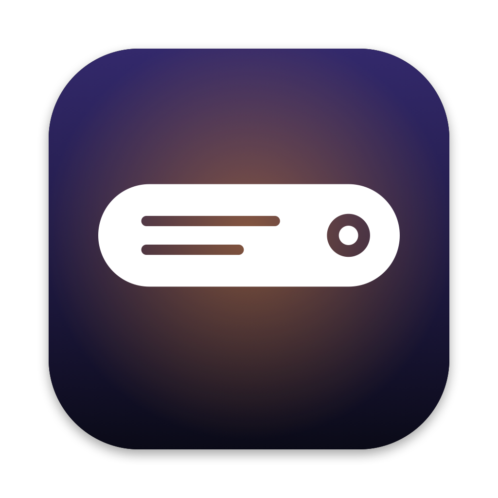

<p align="center">
  
</p>

<h1 align="center">Islet</h1>

<p align="center">
  A voice assistant, a teleprompter, a video downloader and a dozen Mac utilities, living in the Dynamic Island.
</p>

## The island's headline features

### Assistant
Hold <kbd>⌃ control</kbd> + <kbd>⌥ option</kbd>, ask out loud, let go. Or type into the Assistant page.

- **Instant commands, no AI:** "open Spotify", "quit Slack", "volume 30", "mute", "dark mode on", "search for…", "next song", "set a 10 minute timer", "run my Log Water shortcut", "find my lease PDF", "remind me to call Sam in 20 minutes".
- **Sees your screen when you ask about it:** "what's this error?", "summarize this page". Anything else goes to the [Claude Code](https://claude.com/claude-code) you're already signed in to, so it runs on your Claude plan with no API key. Pick Haiku, Sonnet or Opus.
- **Does things, asks first:** replies can open apps and links, search the web or Spotlight, change volume or appearance, start timers, run Shortcuts and add reminders. Quitting apps, running shortcuts and adding reminders wait for your "Do it".
- **Remembers you:** "remember I prefer aisle seats" goes into every later ask; forget items from the ✦ menu.
- Replies are read aloud after spoken asks (toggle with the speaker button). Speech is recognized on your Mac. The closed island shows Listening, Thinking and Talking.

Built from the best of [Atticus](https://github.com/SaarthurR/atticus-mac) and [Plip](https://github.com/hussainn7/plip-oss).

### Teleprompter
Read your script right under the camera, so your eyes stay on the lens.

- **Word tracking** listens and lights up each word as you say it, keeping the current line in view. Click any word to jump there.
- **Classic** scrolls at a set pace, no microphone needed. **Voice-activated** scrolls only while you talk.
- Starting a reading pins the island open; the closed island shows how far through you are. ⌘↩ starts reading from the editor.

The speech engine comes from [Textream](https://github.com/f/textream).

### Video Downloader
Paste a link from YouTube or 1,000+ other sites and download it from the island.

- Video or audio, with Best, 1080p, 720p or 480p quality. A link already on the clipboard is filled in for you.
- Progress shows on the closed island; a finished download is announced, and one click shows it in Finder.
- Uses your installed [yt-dlp](https://github.com/yt-dlp/yt-dlp), or fetches it once on first use. With ffmpeg installed, video and audio streams are merged and audio is saved as M4A.

Modeled on [Parabolic](https://github.com/NickvisionApps/Parabolic).

These pages lead the island's sections: hover the island, or press ⌥⌘K (Assistant), ⌥⌘E (Teleprompter) or ⌥⌘Y (Video Downloader) while it is open.

## Install only what you use

Choose individual features or start with a preset. Uninstalled features stop loading and disappear from the interface; reinstalling restores their settings. Setup asks only for the permissions your choices need.

<p align="center">
  
</p>

Reorder or hide panel sections, choose a compact layout, and export settings to another Mac. The app supports more than a dozen languages.

## Everything it does

### Sound

- **Volume mixer.** Set volume per app, boost quiet audio past 100%, and pin or reorder favorites. No audio driver required.
- **Per app output.** Play music through speakers while a call uses your headset.
- **Output switcher.** Switch audio outputs with a shortcut and lower the volume when headphones disconnect.
- **Microphone tools.** Choose a preferred input, adjust its level on supported devices, and apply available microphone mute or input-volume controls with one shortcut. Siri and some apps may still hear you; Mic Mute is not a privacy lock. Its indicator shows that the feature is on, not that every app receives silence.
- **Music app blocker.** Prevent unwanted Music launches after detected playback-button presses. Requires Accessibility.

### Know what your Mac is doing

- **System monitor.** CPU, GPU, memory, temperatures, battery health and power use, with history graphs and a view of energy-hungry apps.
- **Fan Control (beta).** Set manual fan speeds or temperature curves and monitor live RPM.
- **Menu bar readouts.** Put your chosen readings, usage bars, battery time or fan speed directly in the menu bar.
- **Network.** See live traffic, session totals and your local IP address, or run a speed test.
- **Alerts.** Get notified about sustained CPU load, high temperatures, memory pressure, low disk space or low battery.

### Windows and the Dock

- **App switcher.** Switch between apps and windows with live previews, search and display filters. A simpler mode works without screen capture.
- **Window layout.** Snap windows into layouts, move them between displays and restore earlier positions using shortcuts, screen edges or modifier-drag gestures.
- **Dock Preview.** Hover over Dock icons to preview windows across desktops. Switch, close, move or snap them from the preview.
- **Dock clicks.** Click an active app's Dock icon to minimize, hide or cycle through its windows.
- **Maximize windows.** Use the green button to fill the screen without creating another Space.
- **Fixed Space order.** Keep Spaces in the order you set instead of rearranging them by recent use. Turning it off restores your previous setting.
- **Quit on close.** Quit selected apps when their last window closes.
- **Quit and close protection.** Prevent accidental ⌘Q or ⌘W with a hold, double press or extra modifier, per app.

<p align="center">
  
</p>

<p align="center">
  
</p>

### Keyboard and mouse

- **Text snippets.** Expand short triggers into text with clipboard, date and time variables, or insert snippets from a searchable menu.
- **Smooth scrolling.** Give your mouse wheel a fluid glide with adjustable speed and response.
- **Pointer acceleration.** Disable mouse acceleration and restore your previous setting when turned off.
- **Linear scrolling.** Make every mouse wheel notch scroll the same number of lines, however fast the wheel spins.
- **Focus follows mouse.** Bring the window under the pointer forward after an adjustable pause.
- **Scroll direction.** Invert vertical and horizontal mouse scrolling independently of the trackpad.
- **Scroll sideways while holding a key.** Turn vertical wheel movement into horizontal scrolling while holding a chosen key.
- **Side buttons.** Use mouse Back and Forward buttons in Finder, browsers and compatible apps.
- **Mouse button shortcuts.** Assign keys to extra buttons and side wheels, or use button-drag gestures for Spaces and Mission Control.
- **Middle click.** Turn a three-finger trackpad press into a middle click.
- **Apps to leave alone.** Exclude chosen apps from mouse enhancements.
- **Extra click filter.** Ignore accidental rapid clicks from worn mouse buttons without delaying normal clicks.
- **Key debounce.** Filter repeated letters caused by a worn keyboard.
- **Super key.** Use Caps Lock or a right-side modifier as a shortcut combination, with a separate tap action and app exclusions.
- **Keyboard shortcuts.** Manage feature shortcuts in one place, including optional takeover of supported macOS shortcuts while a feature is active.

### Clipboard, files and links

- **Clipboard history.** Search local text, image and file history, pin favorites, preview entries and paste with shortcuts.
- **Auto clear clipboard.** Clear the system clipboard after a delay, sleep or lock, while keeping saved history.
- **Paste as plain text.** Paste without formatting while preserving the original clipboard content.
- **Shelf.** Park files, text and links near your cursor while dragging, then drop or share them later.
- **Finder shortcuts.** Move files with ⌘X and ⌘V, rename with F2, or paste copied images as PNG files.
- **Clean URL.** Remove tracking parameters from links, manually or automatically.
- **Disk image installer.** Install an app from a mounted disk image and eject it, with optional download cleanup.

### Everyday tools

- **Dynamic Island.** Keep music, notifications, calendars, timers, downloads and everyday controls around the camera cutout, or a simulated one on other Macs. Customize sections and shortcuts, with optional lyrics, a live equalizer, camera preview and file tools.
- **AI agents.** Follow Claude, Codex, OpenCode and GitHub Copilot in the Dynamic Island: plan limits and when they reset where available, tokens, API value, models, projects and live work, with a notice when a long task finishes. Codex's banked resets can be used from there too, and each extra Codex account (`CODEX_HOME`) can have a limits card of its own. Copilot uses local CLI/app session logs; its token totals update when shutdown metrics arrive, and aggregate API-value estimates use base rates.
- **Command Bar.** Search apps, windows, files, clipboard history, snippets and app menu commands from one field. Calculate, convert units, find emoji or run saved scripts.
- **Quick panel.** Open a floating palette of favorite tools with ⌃⌘V.
- **Quick toggles.** Switch appearance, hide desktop icons, eject disks, empty the Trash, lock the screen and more.
- **Quit apps.** See every open app in one list and quit them one by one, all at once or all but the one in front.
- **Radial menu.** Open a customizable wheel of apps, files, shortcuts and tools around the pointer, with profiles and submenus.
- **Scratchpad.** Keep autosaved notes in tabs, with Markdown preview and export, in a floating window or Dynamic Island.
- **Cleaning Mode.** Lock keyboard input while cleaning, with a black screen or a small visible indicator.

### Capture and create

- **Screen capture.** Switch between screenshots, recording, text recognition and color picking in one selector with a pixel magnifier.
- **Screenshot.** Capture an area, window, screen or scrolling page. Annotate, crop, redact, add backgrounds and watermarks, pin captures, send them through the Share menu or share an expiring link.
- **Screen recording.** Record with separate system-audio and microphone tracks. Trim, cut, add automatic zooms, blur private details and export video or GIFs, or share an expiring link.
- **Camera preview.** Check your camera in a floating mirror or Dynamic Island before a call.
- **Copy text from screen.** Recognize text offline from any screen area, or read a QR code.
- **Color picker.** Copy a screen color as HEX, RGB, HSL or SwiftUI code.
- **Media tools.** Compress and edit videos, batch-convert images, add watermarks, make GIFs and extract text, all locally.

### App management

- **App updates.** Check store apps, package-managed apps and supported developer feeds in one list. Install managed updates together or open an app's own updater.
- **Cleaner.** Remove caches, logs and app leftovers, manually or on a schedule.
- **Messaging downloads.** Review, organize or move messaging downloads to the Trash using retention rules.
- **Uninstaller.** Remove apps and review their related caches, preferences and helpers before moving them to the Trash.
- **Homebrew manager.** Search, install and remove formulae and casks without opening a terminal.
- **Port manager.** Find processes listening on network ports and stop them with Kill Process when installed.

### Energy and display

- **Keep awake.** Keep your Mac working on a timer, with the lid closed, or while selected apps, power or external displays are present.
- **Displays.** Control individual displays and brightness, with hardware control where supported, half or quarter steps for the brightness keys, optional extra dimming below a monitor's minimum, and software dimming as a fallback.
- **Extra brightness.** Use a MacBook Pro XDR display's HDR headroom to go beyond its normal maximum brightness.
- **Bluetooth on sleep.** Disconnect Bluetooth during sleep and restore it on wake only if Islet turned it off.


## Build and run

Requires a Mac with Apple Silicon, macOS 14 or newer and the Xcode Command Line Tools.

```sh
./build.sh            # builds and signs Islet.app
./build.sh --install  # installs it into /Applications and launches it
```

To remove Islet with its settings and permissions: `./Tools/uninstall.sh`.

## Private by default

Islet is local-first, with no account, analytics or tracking. The network is touched only by things you start: assistant questions (sent through your Claude Code, with a screenshot only when you ask about the screen), video downloads, the one-time yt-dlp download, the speed test, Homebrew actions and optional online lyric lookup. Automatic updates, temporary share links and in-app feedback are off in this build. Teleprompter speech recognition is done by macOS. See the [privacy notes](docs/PRIVACY.md) and [permissions](docs/PERMISSIONS.md).

## License

[GPL 3.0 or later](LICENSE). Islet is a fork of [Vorssaint Utils](https://github.com/vorssaint/vorssaint-utils); see [THIRD_PARTY_NOTICES.md](THIRD_PARTY_NOTICES.md) for it, Textream and Parabolic.
